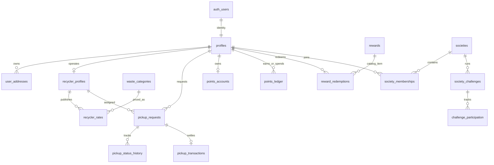

# Supabase setup and implementation status

## Current status

The current branch connects Supabase Auth, session restoration, Google OAuth initiation, password reset, profile setup, pickup creation and status transitions, recycler discovery/rates, private verification document workflows, rewards/redemptions, notifications, reports, admin account/document/report actions, and leaderboard reads. Public landing presentation assets remain static; society dashboards and their private aggregate reporting are not complete. Some other display-only modules may still reference legacy presentation data and require a source audit before production.

The database migration has not been applied to the hosted project, and no PostgreSQL syntax, live database, or RLS integration tests have been run. The Vite production build passed locally. Do not treat frontend compilation as database validation.

## Local setup

1. Create or open the Supabase project `dzfgkeglfjxpltboabol` at the Supabase dashboard.
2. In **Project Settings → API**, copy the project URL and publishable key. The supplied publishable key is intended for browser use; never use a `service_role` or secret key in Vite.
3. This workspace has a local `.env.local` (excluded from Git) containing the URL and publishable key supplied by the owner. `.env.example` contains placeholders only. If these values rotate, update `.env.local` locally.
4. Install dependencies and run `npm run dev`.
5. Apply migrations from the repository root with the Supabase CLI after linking this project: `supabase login`, `supabase link --project-ref dzfgkeglfjxpltboabol`, then `supabase db push`. Review the SQL in `supabase/migrations` before applying it to any database. The migration seeds only waste category identifiers and creates storage buckets; it does not create fake accounts.

## Auth dashboard configuration

- Under **Authentication → URL Configuration**, set the local site URL to `http://localhost:5173` and add `http://localhost:5173/**` to redirect URLs. For production, set the deployed app origin and add its password-reset/login redirect paths.
- Keep email confirmation enabled. Set up custom SMTP under **Project Settings → Auth → SMTP Settings** for dependable production email delivery; the built-in sender is intended for limited evaluation.
- For Google, enable the Google provider under **Authentication → Sign In / Providers**. In Google Cloud OAuth client settings, add the callback displayed by Supabase, exactly `https://dzfgkeglfjxpltboabol.supabase.co/auth/v1/callback`, as an authorized redirect URI. Store the Google client ID and secret in Supabase's provider settings only. Add app origins and callback redirect URLs to Supabase Auth URL Configuration as above. The frontend initiates OAuth and receives the session on `/login`.
- The owner must create the first administrator using the Supabase SQL Editor from a trusted session, after that person has registered and confirmed their account. Resolve their `auth.users.id` by email, then run `update public.profiles set role='admin' where id='<verified-uuid>';`. Restrict SQL Editor access to trusted project administrators. Never expose this privilege through public signup or browser code.

## Authorization matrix (initial schema)

| Resource / action | Household | Recycler | Society manager | Admin |
| --- | --- | --- | --- | --- |
| Own profile and addresses | Read/update allowed profile fields; own addresses | Same | Same | Administrative access |
| Recycler directory/rates | Read verified recyclers/rates | Manage own rates/business profile | Read | Administrative access |
| Pickups | Create through `create_pickup`, read own, cancel while Requested/Accepted | Read assigned, transition assigned pickup through RPC | No access | Read and limited cancellation |
| Points, transactions, redemptions | Read own; redeem through RPC | Read own transactions | No access | Read for administration |
| Verification documents | No access | Upload/read own | No access | Review/read |
| Society memberships/challenges | Self membership/participation | No access | Manage own society | Administrative access |
| Admin audit/reports | Submit/read own report | Submit/read own report | Submit/read own report | Read audit; manage reports |

RLS is not a substitute for security review. The schema needs execution against a disposable Supabase project, policy tests, and review of every grant and RPC before production use.

## Data model overview

## Verification performed

- `npm install --offline` completed successfully.
- `npm run build` completed successfully with Vite 5.4.21. Vite reported the existing main JavaScript chunk exceeds 500 kB.
- No lint, unit, SQL, RLS, or live Supabase tests are configured or have been run. The database migration remains unapplied until the project owner runs the CLI commands above.

## Remaining implementation work

- Complete society manager onboarding, membership privacy-safe aggregates, challenge participation/progress, and society analytics queries.
- Replace remaining legacy demo data in recycler earnings/rating, public impact, and other operational screens; finish pagination/search and per-screen error/retry states.
- Add automated frontend and PostgreSQL/pgTAP tests for auth restrictions, RLS isolation, state transitions, idempotency, storage access, and society/admin boundaries.
- Run the migration and test suite against a disposable local Supabase stack, fix all SQL/policy issues found, and then have an authorized project owner apply the reviewed migration to the hosted project.
- Verify production email delivery, Google OAuth, deployed redirect origins, and all external provider settings.

No payment processor is configured. Pickup transaction rows are bookkeeping only. Environmental calculations remain illustrative estimates in `src/utils/index.js`.
